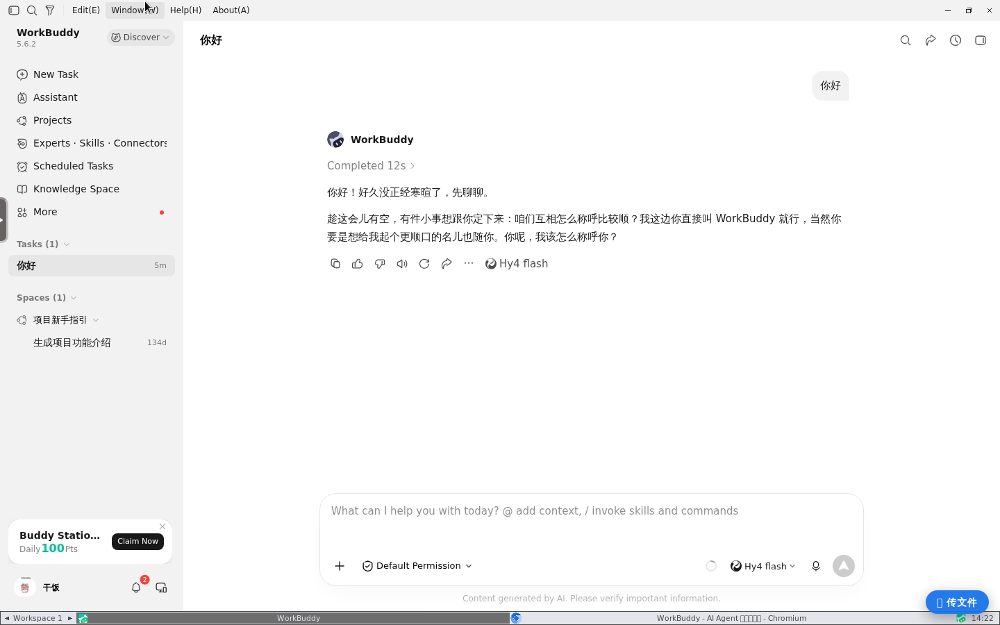
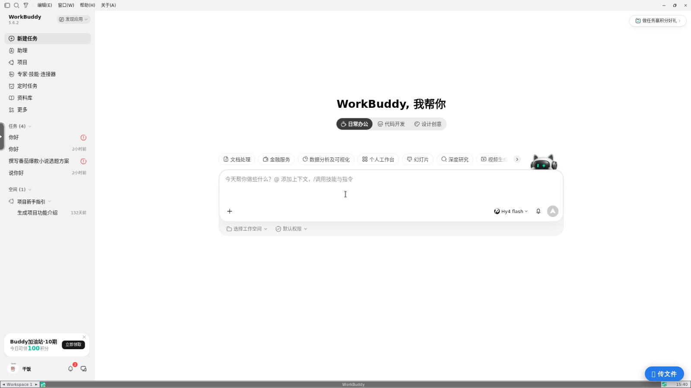
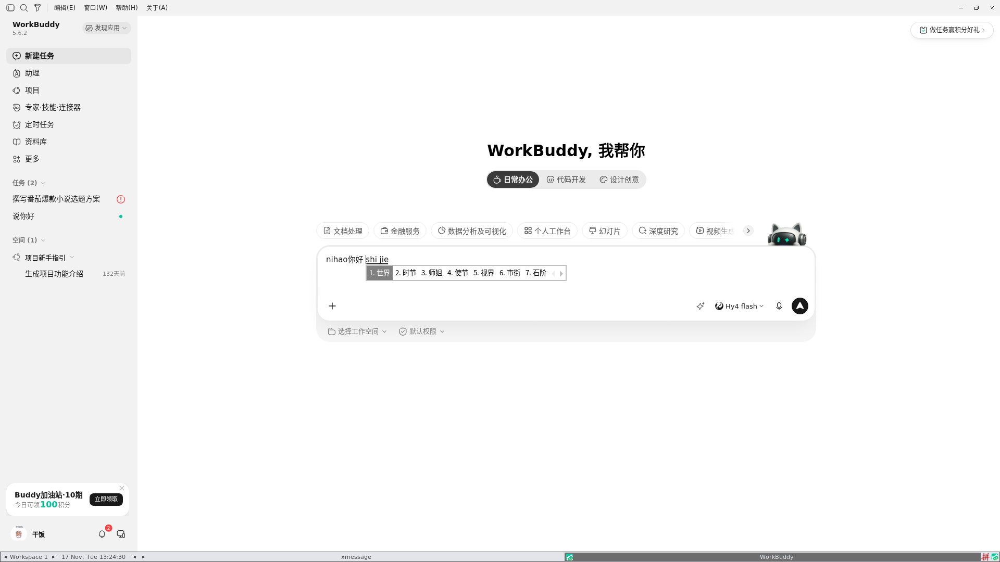
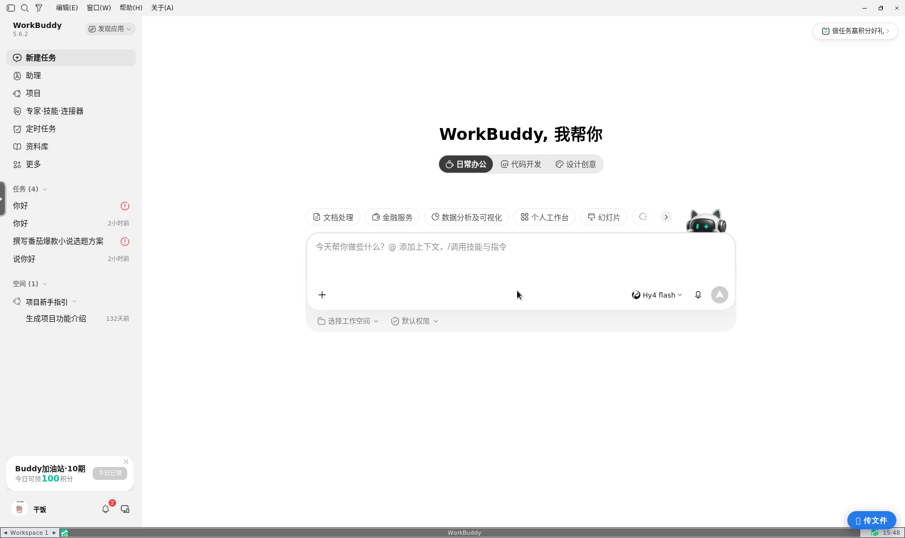
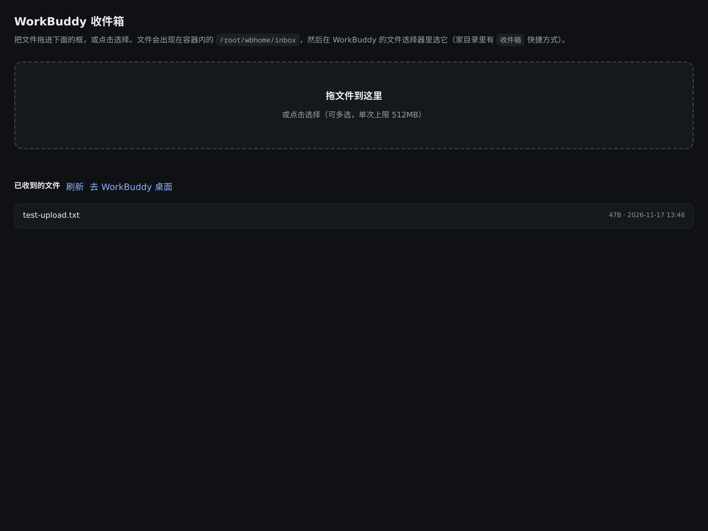

# WorkBuddy in Docker · 在 NAS 上用浏览器跑官方桌面客户端

腾讯 [WorkBuddy](https://www.workbuddy.cn/) 提供 Windows、macOS、手机端，**也提供官方 Linux 版**（deb/rpm，x64 与 arm64），只是 Linux 包走应用商店分发、官网下载页不给直链，也没有公开的 Docker 镜像。这个项目把官方 Linux 客户端装进容器，配 KasmVNC 提供浏览器访问 —— **在极空间 / 群晖这类没有桌面的 NAS 上，也能 24 小时挂着 WorkBuddy**。

跑的是官方客户端本体，登录你自己的账号，专家、资料库、本地定时任务都是真的。



## 特性

| | |
|---|---|
| 官方客户端 | 构建时从腾讯更新接口取最新 Linux 包，**强制 sha256 校验**，不硬编码版本 |
| 浏览器访问 | KasmVNC 远程桌面，HTTP + Basic 认证，支持分辨率自适应 |
| 中文输入 | 内置 fcitx5 拼音，`Ctrl+Space` 切换；双向复制粘贴 |
| 传文件 | 桌面右下角「📎 传文件」上传页，文件落进收件箱（VNC 本身没有文件通道，这是替代方案） |
| 24h 常驻 | `restart: unless-stopped` + tini + 日志轮转 + 健康检查；关掉浏览器不影响它 |
| 性能可调 | `lite` / `balanced` / `quality` 三档，按 NAS 的 CPU 在流畅度与清晰度之间取舍 |
| 多架构 | x86_64 与 ARM64 都支持（官方两种包都有） |

## 快速开始

需要 Docker + Compose，能访问 Docker Hub 与 `download.codebuddy.cn`。

```bash
# 1. 解压到一个目录
mkdir -p /你的/路径/workbuddy && cd /你的/路径/workbuddy
unzip workbuddy-client-deploy.zip --strip-components=1

# 2. 设访问密码（也可直接改 compose 里的 VNC_PASSWORD）
bash install.sh --password '你的密码'

# 3. 在 NAS 的「Docker → Compose → 新建项目」里：
#    项目位置选这个目录 → 粘贴 docker-compose.yml → 确认构建上下文为 "." → 创建
```

首次构建 10~15 分钟（装依赖约 600MB + 下载客户端约 430MB），构建完容器自动启动。

打开 `http://<NAS-IP>:23880/`，用户名 `VNC_USER`（默认 `root`）、密码 = `VNC_PASSWORD`，桌面里点 **Sign In** 扫码登录。

完整步骤、配置项、排障见 **[部署说明](deploy/部署说明.md)**。

## 截图

| 传文件按钮 | 中文输入 |
|---|---|
|  |  |

| 分辨率自适应 | 收件箱上传页 |
|---|---|
|  |  |

## 配置（都在 compose 的 environment 里）

| 变量 | 默认 | 说明 |
|---|---|---|
| `VNC_USER` / `VNC_PASSWORD` | `root` / `iloveppcat` | 访问账号；改用户名后旧账号立即失效 |
| `PERF_PROFILE` | `balanced` | `lite`（2~6 画质/18fps）/ `balanced`（4~8/24fps）/ `quality`（6~9/30fps） |
| `RESOLUTION` / `FIXED_RESOLUTION` | `1440x900` / 空 | 空则跟随浏览器窗口；填 `1280x800` 之类则固定 |
| `DEB_PLATFORM` | `auto` | `auto` / `x64` / `arm64` |
| `DEB_URL` + `DEB_SHA256` | 空 | 留空=取最新版；填了=钉死版本（必须成对） |

端口：桌面 `23880`、上传页 `23881`（宿主侧可改，改完同步 `*_PUBLIC_PORT`）。

## 目录

```
Dockerfile              # 依赖 + KasmVNC + 官方客户端，全部在构建阶段装好
docker-compose.yml      # 唯一入口：创建项目时构建
docker/                 # 容器内脚本与配置（entrypoint / KasmVNC / 输入法 / 上传页）
deploy/部署说明.md       # 完整部署手册（架构、配置、调优、排障）
deploy/install.sh       # 可选：生成密码、建 inbox
docs/                   # 截图与工程说明
scripts/pack.sh         # 打部署包
```

## 说明与边界

- **不是官方项目**，与腾讯无关；仓库里**不含任何腾讯二进制**，构建时由你的机器从官方渠道下载。
- 官方支持形态是 Windows/macOS 桌面端与手机端；容器的 Linux 客户端属于非常规用法。
- 后端始终在腾讯云：断网、账号失效、腾讯改协议都会直接影响使用。
- 没有 GPU，软件渲染，**流畅度不如本地客户端**；这是硬件天花板，不是配置没调好。
- 不要把端口直接暴露公网；需要外网访问请在前面加 HTTPS 反代并换强密码。

## License

脚本与文档：[MIT](LICENSE)。WorkBuddy 本体为腾讯专有软件，版权归腾讯，使用须遵守其用户协议。

---

整理：泡泡猫 · 公众号 **paopaocat888**
